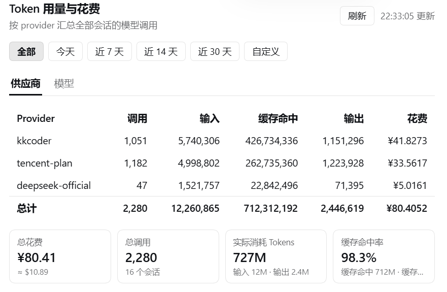
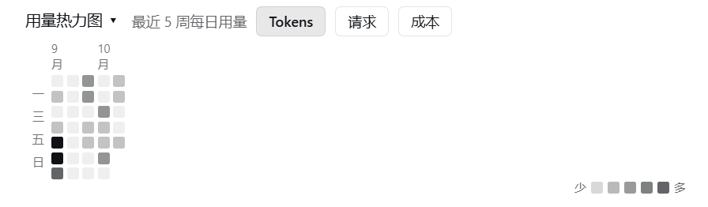

# dsh-usage-report

A DSH plugin that totals token usage and estimated cost **across every session**, broken down by
provider and model, and exposes the result three ways: a `/usage` slash command, a
`GET /api/usage.report` JSON route, and a **Usage** panel in Settings.

[简体中文](README.zh-CN.md) · [Maintenance, deployment and recovery (中文)](docs/MAINTENANCE.md)
· [Sanitized profile example](examples/cordis.patch.example.yml)

This is an in-process DSH plugin, not a standalone server. It has no build step or
separate start command. Provider authentication stays with the host; this plugin
does not accept API keys or load `.env` files. [`.env.example`](.env.example) explains
the optional `DSH_HOME` environment variable.

## Verification

The panel, for reference — a settings section that reads the host's session
projections instead of re-scanning logs:





## Why this exists

DSH's built-in statistics are per-session by design. `dsh-session-stats` publishes a
`sessionStats` projection and `dsh-token-meter` a `totalTokens` projection — both scoped to a
single session — and nothing in the harness consumes pi-ai's cost metadata
(`dsh-llm-pi-ai` documents that "the harness never reads pi-ai's cost metadata … and no
consumer reports spend"). So there is no built-in answer to "what has all of this cost me?"
This plugin fills that gap.

## Features

- **Cross-session totals** per provider and per model: calls, input, cache reads, output, cost.
- **Projection first, scan as fallback** — active sessions are read from an incrementally
  maintained host projection (zero I/O) and cold sessions from the host's durable projection cache
  (also zero log I/O, so restarts do not re-scan); logs are read only when a projection is missing
  or untrusted.
- **Two read paths, one fold** — the projection and the fallback scan share the same fold
  function, so they agree bit for bit (asserted by a test).
- **Catalog-based estimates** — rates are read from the installed pi-ai catalog at call time; no price
  table lives in this repository.
- **No hardcoded exchange rate** — USD by default; CNY only if you supply `cnyPerUsd`.
- **Calendar-day windows** — `/usage 7` means the last 7 calendar days, today included; the panel
  also offers *Today*, *Last 30 days* and an arbitrary **from/to date range**.
- **Responsive panel** — a background warm-up populates the default range at start-up,
  and a request serves the latest snapshot with an *as-of* timestamp instead of waiting.
- **Honest output** — unpriced models are listed explicitly (never silently counted as $0),
  and unreadable sessions are counted rather than hidden.
- **Zero build** — the browser half is a hand-written bundle; the project has no build chain.

Costs are estimates using the installed catalog's DeepSeek rates, not invoices. Gateway
plans and discounts are not included. Unpriced models keep their token counts but have
no known cost included in the total; a zero placeholder does not mean they were free.

## Install

### Option A — path insert (no pnpm needed) · recommended

1. Place the plugin directory inside the profile, e.g.
   `~/.dsh/profiles/web/plugins/dsh-usage-report/`.
2. Add an `insert` row to the profile patch `~/.dsh/profiles/web/cordis.patch.yml`:

   ```yaml
   - insert:
       - id: usage-report
         name: ./plugins/dsh-usage-report/lib/index.js
   ```

3. Restart DSH.

Notes on the path form:

- In an **`insert`** row, a `name` that looks like a path is rewritten to a `file://` URL by the
  patch loader. An `id`-targeted row does **not** perform that rewrite, so path-based loading
  only works through `insert`.
- A relative path resolves against the directory containing the patch file.
- `@deepseek-ai/*`, `@earendil-works/pi-ai` and `zod` resolve upward to the shared
  `~/.dsh/profiles/node_modules` tree, so no dependency installation is required.
- Adding a new `insert` row is **not** hot-applied the way editing an existing row's `config`
  is. Restart DSH after adding it.

### Windows: update an existing local installation

After the path installation has a `.deployment.json` commit/file-hash record, run from the checkout:

```powershell
pwsh -NoProfile -File .\scripts\sync-deploy.ps1
```

Or double-click `update.cmd`. Requires Windows, PowerShell 7.2+, Node 20+, Git, npm and an authenticated
GitHub CLI. It confirms Private visibility, fast-forwards the current origin tracking branch, installs
locked test dependencies, runs checks/tests, backs up the installed plugin and replaces its files.
Finish active DSH tasks first: the default mode briefly restarts the uniquely verified loopback Web
instance. It preserves profile configuration, credentials and sessions; it does not update DSH itself.

Local source edits, unknown/changed installed files and unrecognized hosts stop the update. It never
switches branches or resets local changes: a PR checkout continues tracking that PR branch until you
switch it yourself after merging. See the [maintenance guide](docs/MAINTENANCE.md#windows-一键同步脚本)
for checking without deployment, deploying with DSH closed, and restoring a previous version.

### Option B — a verified published package

Use this only after confirming the npm package's owner, source and version. A private
GitHub checkout does not establish ownership or availability of the same name on npm;
the path install above is the documented route for this private checkout.

```sh
dsh plugin add dsh-usage-report
```

This route requires `pnpm` on the machine.

### Compatibility gate

Before installing, DSH evaluates every `@deepseek-ai/dsh` / `@deepseek-ai/dsh-*` peer range in the
manifest against the running runtime version, with prereleases participating in the range. If a
range does not match, DSH reports the plugin as incompatible and refuses it — pinning an old exact
DSH version is precisely what makes a plugin "disappear". Keep these ranges permissive.

| Peer | Range | Checked by the gate? |
|---|---|---|
| `@deepseek-ai/dsh-commands` | `>=0.2.0-rc.2` | yes |
| `@deepseek-ai/dsh-session-query` | `>=0.2.0-rc.2` | yes |
| `@deepseek-ai/dsh-client-ui-settings` | `>=0.2.0-rc.2` | yes |
| `@deepseek-ai/dsh-client-locale` | `>=0.2.0-rc.2` | yes |
| `@deepseek-ai/dsh-home-paths` | `>=0.2.0-rc.2` | yes |
| `@deepseek-ai/cordis` | `~4.0.4` | no — outside the `dsh` namespace |
| `@deepseek-ai/schemastery` | `~3.18.4` | no — outside the `dsh` namespace |

The five DSH peers use a deliberate open floor (`>=0.2.0-rc.2`) rather than an exact pin: that is
the oldest runtime this plugin has been developed against, and any newer runtime still satisfies
it. Only names in the `@deepseek-ai/dsh` / `@deepseek-ai/dsh-*` namespace are gated, so
`@deepseek-ai/cordis` and `@deepseek-ai/schemastery` are declared without being checked. For
contributors working inside a DSH workspace, the `workspace:^`, `workspace:~` and `workspace:*`
forms also pass the gate, because DSH reads them as "the current runtime version".

`@earendil-works/pi-ai` (used for catalog prices and `calculateCost`) and `zod` (used for the
projection `stateSchema`) are peers flagged optional in `peerDependenciesMeta`, because the DSH
host supplies both. Nothing is bundled and there are no runtime `dependencies` to install.

### Optional: change the display currency

```yaml
- insert:
    - id: usage-report
      name: ./plugins/dsh-usage-report/lib/index.js
      config:
        currency: CNY      # USD (default) | CNY
        cnyPerUsd: 7.20    # example only — supply your own accounting rate
```

## Usage

### Slash command

Available in any profile that has a command registry:

```
/usage                              # all history
/usage 7                            # the last 7 calendar days, today included
/usage 2026-10-01..2026-10-15       # an explicit date range (inclusive)
/usage 2026-10-01..                 # from that date through today
```

The argument must be a positive integer, a `from..to` pair of `YYYY-MM-DD` dates, or omitted.
Anything else (`/usage 0`, `/usage x`, a reversed range) returns the usage hint instead of a report.

### Settings panel

Settings → **Usage**. Top to bottom: range controls, the detail table, then the summary and the
long-term shape, then the notes. The information hierarchy follows
[cc-switch](https://github.com/farion1231/cc-switch)'s usage screen, with the detail table promoted
to the top because "which provider cost what" is what you check most often.

1. **Tabs + table** — per-provider or per-model. Counts and tokens use compact formatting
   (`32.5B`, `343K`); costs show 2 decimals with the exact 6-decimal value on hover.
2. **Summary cards** — estimated total cost, requests, tokens consumed (input + output + cache read + cache
   write) and **cache hit rate** = `cacheRead / (input + cacheWrite + cacheRead)`. Each card carries
   its own breakdown line (USD original, session count, input/output, cache read/write), so every
   raw bucket is visible without a click.
3. **Usage heatmap** — one cell per day, spanning your history (auto-fit, 4–53 weeks), darker means
   more, switchable between **Tokens / Requests / Cost**. Hovering a cell gives that day's exact
   figure. The span is deliberately independent of the selected range, so it always shows long-term
   shape instead of collapsing to one column under `days=7`.
4. **Note lines** — pricing, currency conversion, **data as-of time**, scan statistics, unpriced
   models and unreadable sessions.

Range buttons above the cards: All / **Today** / Last 7 / Last 14 / Last 30 days, plus **Custom**
with two native date pickers (leave one side empty to mean "from the start" or "through today");
changing either date applies immediately. A **Refresh** button next to the toolbar forces a
background recompute instead of waiting, and the label beside it shows when the data was computed.

Every chart is plain DOM/SVG — no charting dependency, consistent with the zero-build design.

### JSON route

```
GET /api/usage.report          # all history
GET /api/usage.report?days=7   # the last 7 calendar days
```

The response is
`{ range, money, total, providers, models, unpriced, sessions, unreadable, steps, currency, unit,
scan, series, asOf, refreshing, refreshError?, refreshAfterMs }`; `providers` and `models` are sorted by cost, descending, and each
bucket carries both `cost` (display currency) and `costUsd` (unconverted). `range` reports `days` or
`from`/`to` depending on which form was used.

`series` is the per-day breakdown (`[{ day, calls, input, output, cacheRead, cacheWrite, cost,
costUsd }]`, ascending by `day`) that the heatmap is drawn from. It is **deliberately independent of
the range** (capped at the last 53 weeks): the heatmap exists to show long-term shape, and a
range-filtered series would collapse it to a single column under `days=7`. Filter `series` by the
window and it sums **exactly** to the totals — the test suite asserts that, because a chart that
disagrees with the cards is a bug, not a rounding difference.

`days` must be a positive integer, and `from`/`to` must be `YYYY-MM-DD` (with `from <= to`);
otherwise the route answers `400`. The route is registered only in profiles that have a Web
connection — without one the slash command still works.

**The route never waits for a cold scan.** If no snapshot exists yet it answers
`{ refreshing: true }` immediately (no partial report), and the panel retries; once a snapshot
exists it is served with `asOf` (epoch ms) and `refreshing` telling you whether a newer one is
being computed. Add **`force=1`** to start a recompute right away — the response is still the
current snapshot with `refreshing: true`, so a click never blocks. During that refresh the
panel uses `poll=1` to check progress without revalidating an existing snapshot again,
including when `ttlMs=0`. A missing snapshot can still be initialized by a poll.

If refresh fails, a last successful report is kept with `refreshError` and
`refreshing: false`; without a report, the route returns 503 with a fixed error message.
Failures do not expose host exception details or trigger endless automatic retries.
Use `force=1` to retry explicitly. Successful report responses include `refreshAfterMs`
for the panel's next routine check. See *Snapshot and warm-up* below.

## How it works

### Projection first

The plugin registers a session projection unit named `usageReport` with the host's
`ctx.sessionProjections`. For each **newly committed** event the host calls `apply(prev, event)`
exactly once — a true incremental fold, never a recompute — and persists the resulting state
under `~/.dsh/storages/session_projcache/`. This is the same mechanism the official
`dsh-token-meter` and `dsh-session-stats` plugins use.

The unit honors the three constraints the host imposes on projections:

1. An event that carries nothing billable must return the **same state reference** — the host
   uses `Object.is` as its change gate.
2. The state must be plain JSON-serializable data; it is written to disk and validated against
   `stateSchema`.
3. `apply` must be pure, because the host may replay it at any watermark.

Two choices are specific to this unit:

- **Only raw tokens are folded, never money.** pi-ai has re-priced its catalog before (flash went
  from $0.14 to $0.30 per million input tokens). A cost baked into the projection would keep the
  old price on disk forever, so cost is always computed at read time from the current catalog.
- **The state carries its own integrity watermark**, described next.

### Deciding whether a projection can be trusted

The host folds a projection unit lazily — the first time a session is touched *after* the unit was
registered. For a session that already existed, that can go wrong in two directions: the fold may
start at index 0 and swallow the fork-inherited prefix (double-billing against the parent session),
or it may cover only the events committed after registration (undercounting).

The state therefore records two watermarks: `inherited` (the inherited-prefix length handed to
`init`) and `headSeq` (the `seq` of the first event this unit ever saw — recorded once per session,
even when that event carries no usage).

| Relationship | Meaning | Trusted? |
|---|---|---|
| `headSeq === inherited` | folded exactly from this session's first own event | ✅ |
| `headSeq > inherited` | head is missing (registered late, or a partial lazy fold) | ❌ fallback scan |
| `headSeq < inherited` | folded into the inherited prefix — would double-bill | ❌ fallback scan |
| `headSeq === null` | the unit has never seen an event | ❌ fallback scan |

The last row matters most: an empty state could mean "this session really has no billable events"
or "the unit never ran", and those are indistinguishable from the state alone. This plugin prefers
one extra log read over silently undercounting. The converse — "has own events, none of them
billable" — *is* trusted, because those events still set `headSeq`.

### Fallback scan and its cache

A session is read from its log and folded locally only when its projection is unavailable or
untrusted — that is, on the very first aggregation after install, or when the host has no durable
checkpoint for it yet.

Cold sessions (not mounted in this process) read the host's durable projection cache instead:
because the unit declares a `wire` view, `sessionProjectionCache.cachedSnapshot()` returns its state
with **zero log I/O**, so a restart does not re-scan history. Declaring `wire` is not about the
browser here — it is the only public path that exposes a unit's persisted state for cross-session
reads. The state is tiny (measured: 5.8 KB for 15 sessions whose logs total 13.3 MB), so the extra
payload is negligible. The host checkpoints at `session/created`, `turn/end` and `session/disposed`.

The fallback path caches its per-session result keyed by the `revision` the persistence layer
derives from `stat` (`dev:ino:size:mtimeNs:ctimeNs`) — a single `stat` is enough to detect any
content change. What is cached is the folded state (raw tokens bucketed by provider, model and
local day), never prices, and it is tiny compared with the logs it replaces: measured at 5.8 KB
total for 15 sessions / 13.3 MB of logs, about 0.04%. The cache is a bounded LRU (2048 entries by
default), refreshes on hit, and evicts sessions that no longer exist. If the persistence layer is
unavailable, or a session has no revision yet, that session is simply not cacheable: a missing
revision must never fail a report.

The cache also **survives process restarts**: it is written once per aggregation (atomically —
temporary file, then rename) to `<dsh home>/cache/dsh-usage-report/fallback-cache.json`, resolved
through the host's `dshCachePath`. This matters because a session you never open again never gets a
host checkpoint, so without the file every restart would re-scan it — and that cost grows with
history. The file records the projection `stateVersion`, so a change in fold semantics invalidates
it wholesale instead of reusing stale-shaped data; a missing, corrupt or unreadable file is simply
an empty cache.

Cold reads are bounded to 4 concurrent sessions so that reporting does not fight the foreground
agent for I/O. Both paths run the same fold, and a test asserts their outputs are identical by
driving the same synthetic sessions through each.

### Why the cache is not optional

`sessionQuery.readSession` reads and **replay-validates** an entire session log, while DSH's own
caches only cover sessions in flight between adjacent steps: the JSONL persistence layer memoizes
the last 2 parsed logs (`COLD_LOG_MEMO_MAX_ENTRIES = 2`) and `dsh-session-query` keeps a 5-entry
prepared-session cache (`SESSION_QUERY_DEFAULT_PREPARED_SESSION_CACHE_SIZE = 5`). Beyond that scale
they thrash, and every report degrades to O(all history) — measured at roughly 710 ms for
11 sessions / 11.4 MB of logs on the development machine, and that figure is a lower bound because
it excludes replay validation and per-event cloning.

Actual aggregation work is observable: the command output and the panel both print
`projected / scanned / reused / elapsedMs`.

### Snapshot and warm-up

Caching removes repeated work, but it cannot remove the first one: after a restart, every session
that changed since the last run has to be read once. That read is expensive — `readSession`
replays and validates the whole log and clones every event, measured at **~1.6 s per session**
(4 changed sessions ⇒ 6.3 s on the development machine, against 13 sessions / 13 MB).

The web panel uses **snapshots**, while commands wait for a newly computed result:

- At start-up (after `warmupDelayMs`, disabled with `warmup: false`) it computes the default
  range in the background, so the first panel open already has data.
- A request serves the newest snapshot for its range immediately, together with
  `asOf` (epoch ms) and `refreshing`. If nothing exists yet, the route answers
  `{ refreshing: true }` and the panel retries every 1.5 s.
- A snapshot older than `ttlMs` is still served at once, and a refresh starts in the background
  (stale-while-revalidate). Concurrent requests for the same range share one refresh.
- `/usage` starts a new aggregation even if a fresh snapshot exists, or joins the task already
  running for that range. It waits for the result and reports failure instead of silently
  returning an older success. Per-session caches still avoid unnecessary log scans.
- After receiving a stable report, a visible panel checks again every `ttlMs`, clamped to
  30 seconds through one hour. Hidden panels pause checks; becoming visible checks again.
  Active refreshes are polled every 1.5 seconds with `poll=1`. Unmounting clears timers,
  listeners and the request. Failures preserve same-range data and require a manual retry.

`ttlMs` controls HTTP revalidation on demand, not an always-running background job or
a guarantee of end-to-end freshness. The polling interval, read duration, visibility,
failures and the host's own checkpoint state also affect the data shown.

## Configuration

| Key | Type | Default | Meaning |
|---|---|---|---|
| `currency` | `'USD' \| 'CNY'` | `'USD'` | Display currency. Aggregation is always USD internally. |
| `cnyPerUsd` | number ≥ 0.01 | — | CNY per 1 USD. Read only when `currency: CNY`. |
| `warmup` | boolean | `true` | Compute the default range (all history) in the background after start-up, so the first panel open does not wait for a cold scan. |
| `warmupDelayMs` | number ≥ 0 | `2000` | Delay before that warm-up runs, to stay out of the busiest part of start-up. |
| `ttlMs` | number ≥ 0 | `30000` | HTTP snapshot freshness. A normal stale request starts a background refresh; progress polls do not revalidate an existing snapshot. Commands always aggregate. |

No exchange rate is built in. An exchange rate is an accounting policy — settlement rate, platform
rate, and so on — so guessing one would be both inaccurate and out of scope. Requesting
`currency: CNY` without a valid `cnyPerUsd` falls back to USD and says so: the command prints a
fallback warning line, and the JSON carries `money.fellBack: true`. The plugin's `Config` schema
accepts only `USD` or `CNY` — any other value is rejected when the plugin loads — while the
converter used for display treats an unrecognized currency as USD.

Aggregation keeps USD as its canonical unit, because that is the unit of the price catalog, and
conversion happens only in the presentation layer. This keeps the physical quantity and its
rendering separate, and lets the JSON expose both `cost` and `costUsd` so any line can be checked
against the catalog.

## Pricing

Prices are never hardcoded. They are read at call time from the pi-ai built-in catalog via
`getBuiltinModels('deepseek')`, and cost is computed with pi-ai's own `calculateCost`, in USD per
million tokens. Upgrading the catalog updates the prices with no code change.

Resolution order: explicit override → model id as-is → normalized match → unpriced. The override step
is part of the `pricing.js` / `aggregate.js` module API (`resolve(provider, model)`); it is not exposed
as plugin configuration, so in practice resolution starts at the exact-id step.

Normalization strips a routing prefix (`x/`), a trailing 6–8 digit date, a version token (`v4`,
`v4.1`), and every non-alphanumeric character. If two catalog entries collide after normalization,
the key is left deliberately unmatched instead of guessed.

| Model id in the log | Normalized key | Matches catalog entry | Via |
|---|---|---|---|
| `deepseek-flash` | `deepseekflash` | `deepseek-flash` | exact id |
| `deepseek-v4-pro` | `deepseekpro` | `deepseek-v4-pro` | exact id |
| `deepseek-v4-flash` | `deepseekflash` | `deepseek-flash` | normalized |
| `deepseek/deepseek-flash` | `deepseekflash` | `deepseek-flash` | normalized |
| `deepseek-v4-pro-202606` | `deepseekpro` | `deepseek-v4-pro` | normalized |

A model that resolves to nothing is listed under **unpriced**, in the command output and
`unpriced` in JSON. Its token counts remain included, but its unknown cost is excluded
from the estimated total (numeric cost fields use zero as a placeholder). It is not free;
the total may be understated by an unknown amount.

## Correctness notes

Two things are easy to get wrong, and both are handled deliberately:

1. **Fork-inherited events are skipped in full.** The log returned by `readSession` begins with
   `inheritedEventCount` events inherited from a parent session, already counted there. The
   fallback path slices that prefix off before folding; the projection path is guarded by the
   watermark check above. Counting the prefix twice double-bills the parent's usage.
2. **`inputTokens` excludes cache hits.** The harness sums four *disjoint* buckets —
   `inputTokens + cacheReadTokens + cacheWriteTokens + outputTokens` — as `dsh-token-meter`'s
   `usageTokens` does under the comment "sum disjoint provider usage buckets without double-counting
   reasoning output". Treating "input" as a prompt total is therefore wrong by exactly the cached
   volume, which is usually the largest term. Cache reads and cache writes are priced at their own
   catalog rates, which differ from the input rate by orders of magnitude.

Further invariants:

- `days` windows are **local calendar days**: `days: 7` covers the last 7 local days including
  today, not a rolling 168-hour window. Projection state is bucketed by local calendar day, which
  keeps the state minimal and matches the day-granularity semantics of the panel.
- Cost is recomputed from the current catalog for historical usage, so a report answers "what would
  this usage cost today", not "what was invoiced then".
- `provider` and `model` come from `event.data.message.source`; when either is missing, the event is
  bucketed under `(未知)`.
- Route keys separate provider from model with a NUL byte and store both values in the value, so a
  provider or model containing `/` cannot be mis-split. The JSON splits on the first `/` for display,
  which round-trips for real model ids.
- Cache writes are folded, priced and serialized (`cacheWrite` in every JSON bucket), but neither the
  command table nor the panel gives them a column of their own; the JSON is the place to read them.

## Limitations

- **The durable checkpoint can lag a crashed turn.** The host writes checkpoints at turn boundaries,
  so a session that was mid-turn when the process died may be a few events short in the cache. It
  repairs itself the next time the session is opened (the host folds the tail from the checkpoint).
  The watermark check cannot see this, because the head is intact.
- **Sessions that predate the install may never be trusted.** Their projection can be judged
  incomplete by the watermark criterion and will keep using the fallback path.
- **The panel displays snapshots.** Visibility, check intervals, read duration and failures affect
  freshness; inspect the as-of time. `/usage` waits for its aggregation, but the available host
  projections and checkpoints can still omit tail events after an abnormal exit.
- **Cost is the official DeepSeek list price applied to your usage.** A third-party gateway may bill
  differently (plans, discounts, peak/off-peak pricing). The number is an official-price equivalent,
  not your invoice.
- **Unpriced models can understate the estimated cost by an unknown amount.** Their token usage
  is retained and they are listed explicitly; zero cost fields do not establish free usage.
- **The host half's user-facing strings are Chinese** — the `/usage` output, route error messages,
  and the JSON `unit` field. Only the Web panel is localized (Chinese and English).
- **The projection state version is part of the on-disk contract.** Any change to fold semantics
  must bump `USAGE_PROJECTION_VERSION`, or rows already on disk will be read as valid data.
- **Cacheability depends on the persistence layer.** Without `sessionPersistence`, or without a
  revision for a session, the fallback path re-reads that session every time — correct, just slower.

## Development

Install the locked development/test dependencies before running the suite. DSH
services are mocked, so a running host is not needed. Wiring tests use an isolated
temporary DSH home and do not read or prune the user's real cache.

```sh
npm ci --ignore-scripts --no-audit --no-fund
npm run verify -- --version 0.2.0-rc.2
npm test       # → node --test, from the manifest's `test` script
node --test    # equivalent, straight from a checkout
```

Node ≥ 20 is required (declared in `engines`). `verify` checks module syntax, the
manifest, client bundle id and the stated DSH peer floor. Without `--version`, it
tries to detect a local host and explicitly skips the gate when none is found.
This does not replace testing against the actual deployment host.

The suite targets the things that fail silently rather than loudly:

- the same-reference contract for irrelevant events, and the one-shot `headSeq` record;
- all four watermark relationships, including the inherited-prefix case that would double-bill;
- that the projection path and the fallback path produce identical output;
- that `days` windows are calendar-day based;
- that a fallback result is reused while its revision is unchanged;
- that unpriced models are surfaced, and that one unreadable session cannot fail the report;
- that `apply()` really registers all three outlets (projection unit, command, route) and that a
  missing `sessionProjections` or `connection` service degrades instead of crashing;
- that the route answers `400` for a malformed `days` and JSON otherwise;
- that `Config` defaults to USD with no built-in rate;
- that the client bundle registers under the right id, exports `apply`/`inject`, registers the
  settings slot, and carries matching zh/en key sets with no dead placeholders.

### Layout

| File | Half | Responsibility |
|---|---|---|
| `lib/index.js` | host | Cordis plugin: registers `/usage` and the JSON route; the only wiring layer |
| `lib/aggregate.js` | host | Cross-session aggregation and JSON serialization |
| `lib/projection.js` | host | The `usageReport` projection unit, the shared fold, the integrity criterion |
| `lib/cache.js` | host | Per-session fallback cache, invalidated by `revision`, LRU-bounded |
| `lib/pricing.js` | host | Catalog lookup and model-id normalization |
| `lib/currency.js` | host | Display-currency conversion (presentation only) |
| `lib/render.js` | host | Markdown rendering for the command output |
| `lib/client.js` | client | Settings panel |
| `test/`, `scripts/verify.mjs` | development | Synthetic-data tests and plugin self-check |
| `examples/`, `.env.example` | configuration | Sanitized profile fragment and host environment reference |
| `docs/MAINTENANCE.md` | operations | Data boundaries, deployment, rollback, recovery and secret-review procedure |

The browser half is a **hand-written, zero-build bundle** in the
`window.__ModuleLoader__.load({ id, factory })` form, because the host serves the file as-is and
nothing generates the wrapper. Its factory is lazy, so the module body runs on first import. It
requires only `react` from the platform's static module table; everything else is implemented
locally so the panel cannot depend on an unverified component contract. That is also why it looks
plainer than native panels.

## Maintenance and recovery

The [maintenance guide](docs/MAINTENANCE.md) describes the dependency model,
host-owned session data, rebuildable caches, deployment checks and recovery limits.
Keep actual profiles, provider credentials, session logs, backups and usage exports
outside the checkout. `.gitignore` is a guard against accidental commits, not permission
to delete files. The hand-written `lib/client.js` and referenced documentation PNGs are
source assets. GitHub Actions only installs, verifies and tests; it does not deploy.

Review all fetched Git history and the working tree for secrets, then inspect the staged
changes and recheck GitHub visibility before committing and pushing. Stop if real secrets
have entered history, privacy is lost, or credential rotation/history rewriting is needed.

## License

MIT — see [LICENSE](./LICENSE).
